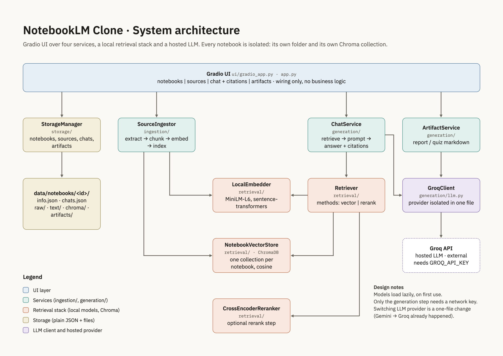

# NotebookLM / Gemini Notebook Clone

A small NotebookLM-style app (CS/IT 5010 project). Create notebooks, add sources (PDF, PPTX, TXT, web URL), chat with them using RAG with visible citations, and generate a Report or a Quiz (with answer key) as downloadable Markdown.

- **Live demo:** https://notebooklm-clone-4ygpfpzriq-uc.a.run.app (Google Cloud Run; notebooks reset when the instance is replaced, see Storage and persistence)
- **Docs:** [Spec](SPEC.md) · [Architecture](docs/ARCHITECTURE.md) · [RAG evaluation](docs/EVALUATION.md) · [Demo checklist](docs/DEMO_CHECKLIST.md)
- **Detail Report:** [End-to-End Prodject Report](https://drive.google.com/file/d/1sjtiOFgDHkmLj74nw9Pyv9BkQJwfcMIT/view?usp=sharing)

## Stack
Gradio UI · ChromaDB (one collection per notebook) · `sentence-transformers/all-MiniLM-L6-v2` embeddings · cross-encoder reranker (`ms-marco-MiniLM-L-6-v2`) · Groq-hosted LLM (`openai/gpt-oss-120b`).

## Architecture



More diagrams: [ingest flow](docs/images/ingest-flow.png) · [chat flow](docs/images/chat-flow.png) · [artifacts and data model](docs/images/artifacts-data-model.png) · [deployment](docs/images/deployment.png)

The Gradio UI is wiring only; all logic lives in four services. Retrieval runs on local models, and only answer generation calls a hosted LLM. Each notebook has its own folder and its own Chroma collection, so retrieval can never cross notebooks.

| Component | Package | Role |
|---|---|---|
| `StorageManager` | `storage/` | notebooks, sources, chats, artifacts as JSON + files |
| `SourceIngestor` | `ingestion/` | extract -> chunk -> embed -> index |
| `ChatService` | `generation/` | retrieve -> prompt -> answer + citations |
| `ArtifactService` | `generation/` | report / quiz Markdown |
| `Retriever` | `retrieval/` | `vector` or `rerank`; uses `LocalEmbedder`, `NotebookVectorStore` (Chroma, cosine), `CrossEncoderReranker` |
| `GroqClient` | `generation/llm.py` | the only file that knows the LLM provider (Gemini -> Groq was a one-file change) |

Models load lazily on first use.

**Ingest flow:** source in (PDF, PPTX, TXT or URL) -> raw copy in `raw/` -> extract text per page or slide (pypdf, python-pptx, requests + BeautifulSoup) -> `text/<source_id>.txt` -> chunk (900 chars, 120 overlap, word boundaries) -> embed in batch (MiniLM-L6) -> index in the notebook's Chroma collection -> source record appended to `info.json`. Any error stores the source with `status=failed` and the error message. Chunks never span pages or slides, so every citation points to an exact page or slide. Chroma metadata: `notebook_id`, `source_id`, `source_name`, `page_or_slide`, `chunk_index`, `url`.

**Chat flow (RAG):** question -> embed -> vector search (top-N in this notebook) -> optional cross-encoder rerank (skipped for `vector`) -> keep top 5 -> prompt of numbered passages plus the last 4 messages -> Groq call, answering from context only with `[n]` citations -> answer plus citation list (source, page/slide, URL, chunk, snippet) -> messages appended to `chats.json`. Each saved message holds `id`, `role`, `content`, `timestamp`, `citations[]`, `method`, `latency_s`.

**Artifacts:** all chunks of the notebook are sampled evenly (up to 30k characters), sent to the LLM with a report or quiz prompt, saved as `.md` in `artifacts/`, and recorded in `info.json`.

**Data model:** `info.json` holds `id`, `name`, `created_at`, `updated_at`, `sources[]` (`id`, `type`, `name`, `path`, `status`, `metadata`) and `artifacts[]` (`id`, `type`, `filename`, `path`, `created_at`). `chats.json` is a list of messages.

**Deployment:** a push to `main` runs tests, builds the Docker image (CPU-only torch, both models baked in), pushes to Artifact Registry and deploys to Cloud Run (2 GiB, 2 vCPU, max 1 instance, scale to zero). `GCP_SA_KEY` is a GitHub secret; `GROQ_API_KEY` is set on the Cloud Run service and never stored in the repo.

Full diagrams and details: [docs/ARCHITECTURE.md](docs/ARCHITECTURE.md).

## Run locally
```bash
python3.10 -m venv .venv && source .venv/bin/activate
pip install -r requirements.txt
cp .env.example .env        # then put your key in .env
python app.py               # http://localhost:7860
```
Tests (offline, no key needed): `pip install -r requirements-dev.txt && python -m pytest tests -q`
RAG evaluation (needs the key): `python -m eval.run_eval`

## Configuration (environment variables)
| Variable | Required | Default |
|---|---|---|
| `GROQ_API_KEY` | yes | none |
| `GROQ_MODEL` | no | `openai/gpt-oss-120b` |

Never commit keys. `.env` and `data/` are gitignored. On Cloud Run set `GROQ_API_KEY` as an environment variable or Secret Manager secret (see CI/CD below).

## Using the app
1. Create a notebook (top bar), or pick an existing one.
2. **Sources** tab: upload PDF/PPTX/TXT or paste a URL. The table shows status and chunk counts; failures show the error.
3. **Chat** tab: ask questions. Choose `rerank` (vector + cross-encoder) or `vector`. Citations (source, page/slide, chunk, snippet) appear under the answer. History is saved per notebook.
4. **Artifacts** tab: generate a Report or Quiz, view it, and download the `.md`.

## Storage and persistence
Everything for a notebook lives in `data/notebooks/<notebook_id>/` (`info.json`, `chats.json`, `raw/`, `text/`, `chroma/`, `artifacts/`) behind the `StorageManager` class.

**Cloud Run limitation:** the container disk is ephemeral. Data survives while an instance is running but **is lost when the instance is replaced** (idle scale-to-zero, every deploy, or a crash). Persistence is best effort; this is a deliberate simplification. The service is capped at one instance so a session never splits across instances. Options for real persistence (not implemented): mount a Cloud Storage bucket at `data/`, or use Filestore. Details in [docs/ARCHITECTURE.md](docs/ARCHITECTURE.md#persistence-limits).

## Docker
```bash
docker build -t notebooklm-clone .
docker run --rm -p 8080:8080 -e PORT=8080 -e GROQ_API_KEY=... notebooklm-clone   # http://localhost:8080
```

## CI/CD (GitHub Actions -> Google Cloud Run)
`.github/workflows/deploy.yml`: on push to `main`, run tests, build the image, push it to Artifact Registry, and deploy to Cloud Run.

One-time GCP setup (replace `PROJECT` and region as needed):
```bash
gcloud config set project PROJECT
gcloud services enable run.googleapis.com artifactregistry.googleapis.com
gcloud artifacts repositories create notebooklm --repository-format=docker --location=us-central1

# deploy service account
gcloud iam service-accounts create gh-deployer
SA=gh-deployer@PROJECT.iam.gserviceaccount.com
for r in roles/run.admin roles/artifactregistry.writer roles/iam.serviceAccountUser; do
  gcloud projects add-iam-policy-binding PROJECT --member=serviceAccount:$SA --role=$r
done
gcloud iam service-accounts keys create key.json --iam-account=$SA   # paste into GitHub secret, then DELETE key.json
```
GitHub repo -> Settings -> Secrets and variables -> Actions:
- **Secret** `GCP_SA_KEY`: contents of `key.json`.
- **Variables** `GCP_PROJECT_ID` and `GCP_REGION` (e.g. `us-central1`).

After the first deploy, set the LLM key once (the workflow never touches it):
```bash
gcloud run services update notebooklm-clone --region us-central1 --update-env-vars GROQ_API_KEY=...
```

## Project layout
```
app.py            entry point        ui/          Gradio wiring
Dockerfile        container image    .github/     CI/CD workflow
storage/          notebook storage   ingestion/   extract, chunk, embed, index
retrieval/        embedder, Chroma, reranker      generation/  chat, artifacts, LLM client
eval/             retrieval comparison            tests/       offline tests
docs/             architecture, evaluation, demo checklist
```

## Limitations
- Scanned/image-only PDFs have no extractable text and fail with a clear error (no OCR).
- Web pages that need JavaScript to render are not supported.
- Ephemeral storage on Cloud Run (see above); first request after idle takes several seconds (cold start).
